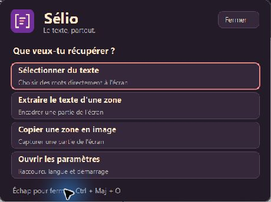
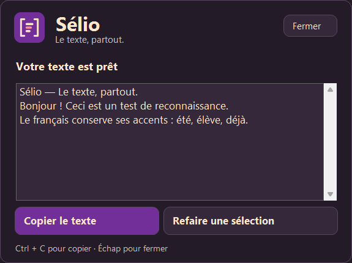
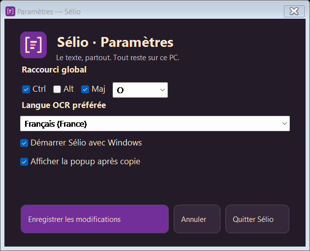

<p align="center">
  
</p>

<h1 align="center">Sélio</h1>
<p align="center"><strong>Le texte, partout.</strong></p>
<p align="center">Capturez une zone de votre écran, reconnaissez son texte et collez-le où vous voulez.</p>
<p align="center">Windows 11 x64 · OCR local · Sans compte · Sans télémétrie</p>
<p align="center">
  <a href="https://github.com/janjawish/selio/releases/latest"><strong>Télécharger Sélio</strong></a>
  · <a href="#prise-en-main">Prise en main</a>
  · <a href="#compiler-et-tester">Compiler et tester</a>
</p>

<p align="center">
  
</p>

## Installation

Téléchargez une archive dans la [dernière version GitHub](https://github.com/janjawish/selio/releases/latest), extrayez-la dans un dossier de votre choix et double-cliquez sur **`Selio.exe`**. Gardez les fichiers extraits ensemble. Sélio apparaît près de l’horloge Windows et s’ouvre avec **Ctrl + Maj + O**.

| Archive | Contenu | Taille extraite de la V1 |
| --- | --- | ---: |
| `Selio-1.0.0-win-x64-autonome.zip` | Runtime .NET inclus. À choisir pour un premier essai. | ~142 Mio |
| `Selio-1.0.0-win-x64.zip` | Nécessite le [.NET Desktop Runtime 10 x64](https://dotnet.microsoft.com/download/dotnet/10.0). | ~25 Mio |

Le démarrage avec Windows est activé par défaut. Vous pouvez le désactiver depuis l’icône près de l’horloge ou le bouton **Ouvrir les paramètres**.

## Prise en main

Placez le pointeur sur le moniteur à utiliser, puis appuyez sur **Ctrl + Maj + O**. Choisissez l’action qui correspond à ce que vous voulez récupérer.

| Action | Geste | Résultat |
| --- | --- | --- |
| **Sélectionner du texte** | Cliquez sur un mot ou glissez du premier au dernier mot. | Un aperçu modifiable, avec les sauts de ligne reconnus. |
| **Extraire le texte d’une zone** | Tracez un rectangle autour du contenu. | Le texte reconnu dans cette zone, prêt à copier. |
| **Copier une zone en image** | Tracez un rectangle autour du contenu. | Une image dans le presse-papiers, prête à coller avec **Ctrl + V**. |

Dans l’aperçu, cliquez sur **Copier le texte** ou appuyez sur **Ctrl + C**. Si vous sélectionnez une partie du texte dans le champ, seule cette partie est copiée. **Échap** annule une sélection ou ferme la popup. Vous pouvez aussi fermer la popup en cliquant à côté ou en pressant de nouveau le raccourci.

<table>
  <tr>
    <th>Aperçu du texte reconnu</th>
    <th>Paramètres</th>
  </tr>
  <tr>
    <td valign="top"></td>
    <td valign="top"></td>
  </tr>
</table>

Le lanceur a été capturé sur Windows 11. Les deux aperçus ci-dessus sont des rendus hors écran des contrôles WinForms de Sélio. Le résultat provient du moteur OCR appliqué à une mire synthétique.

## Langues et réglages

Sélio utilise la [reconnaissance optique de Windows](https://learn.microsoft.com/windows/uwp/api/windows.media.ocr.ocrengine). **Automatique** privilégie les langues du profil Windows. La liste propose les modules OCR déjà installés, dont le français et l’anglais s’ils sont disponibles. Pour en ajouter un, ouvrez **Paramètres Windows → Heure et langue → Langue et région → Options linguistiques** et installez le composant **Reconnaissance optique des caractères** de la langue voulue.

Les réglages permettent de modifier le raccourci, de choisir la langue, d’activer le lancement avec Windows et de fermer la popup après une copie réussie. Si un nouveau raccourci est déjà pris, Sélio conserve l’ancien. Le JSON est stocké dans `%LocalAppData%\Selio\settings.json`.

## Confidentialité et limites

- Sélio capture le moniteur une seule fois, après le choix d’une action. Les vidéos et pages animées peuvent évoluer pendant la sélection. L’extraction correspond à l’instant de la capture.
- La sélection laisse le bureau visible, avec seulement des contours pour délimiter la zone ou les mots. L’OCR suit les mots reconnus et leur ordre de lecture. Relisez les accents, la ponctuation, le code et les mises en page à colonnes.
- Les très grandes images sont réduites à la taille acceptée par le moteur OCR, puis les coordonnées sont remappées aux pixels d’origine. La copie d’image conserve la taille de la zone sélectionnée.
- Les bureaux verrouillés ou sécurisés et les surfaces protégées peuvent empêcher une capture ou produire une zone noire.
- La reconnaissance et la capture se font localement. Sélio ne conserve ni historique, ni image, ni texte extrait sur disque. Les données que vous copiez sont gérées par le presse-papiers Windows et ses réglages d’historique ou de synchronisation.

Pour désinstaller Sélio, désactivez **Démarrer Sélio avec Windows** et enregistrez. Choisissez ensuite **Quitter Sélio** près de l’horloge et supprimez le dossier extrait. Vous pouvez aussi supprimer `%LocalAppData%\Selio` pour effacer les réglages.

## Compiler et tester

Ouvrez PowerShell à la racine du dépôt avec le [SDK .NET 10](https://dotnet.microsoft.com/download/dotnet/10.0) installé.

```powershell
.\scripts\dotnet.ps1 build .\Selio.slnx -c Release
.\scripts\test.ps1
.\scripts\publish.ps1
```

Les deux publications sont écrites dans `artifacts/self-contained/` et `artifacts/framework-dependent/`. Utilisez `-FrameworkOnly` pour publier uniquement la version avec runtime séparé. Le projet est en C# et WinForms, avec les contrats Windows intégrés par le SDK .NET. La zone de notification et le raccourci Win32 fonctionnent par événements. Le projet cible PerMonitorV2 et traite les sélections dans les pixels physiques du moniteur.

Les **60 tests unitaires** couvrent les sélections OCR, la reconstruction du texte, la géométrie, le DPI et la validation des réglages. Les essais natifs ont validé le conflit de raccourci, le presse-papiers texte et image et la reconnaissance française sur Windows 11. Consultez le [protocole de vérification](docs/verification.md) pour rejouer ces essais et vérifier le glisser, les moniteurs à DPI différents et le démarrage automatique.

```powershell
.\scripts\benchmark.ps1
```

Le benchmark mesure cinq minutes au repos, puis 20 cycles d’usage et 30 cycles supplémentaires sur une mire. Il produit des CSV et un rapport Markdown dans `artifacts/benchmarks/`. Lancez-le sur un bureau libre. Il déplace le pointeur et remplace le presse-papiers par le texte de test. Le seuil de 70 Mio de mémoire résidente au repos est un objectif de mesure. Les résultats dépendent de Windows, des modules OCR et du matériel.
